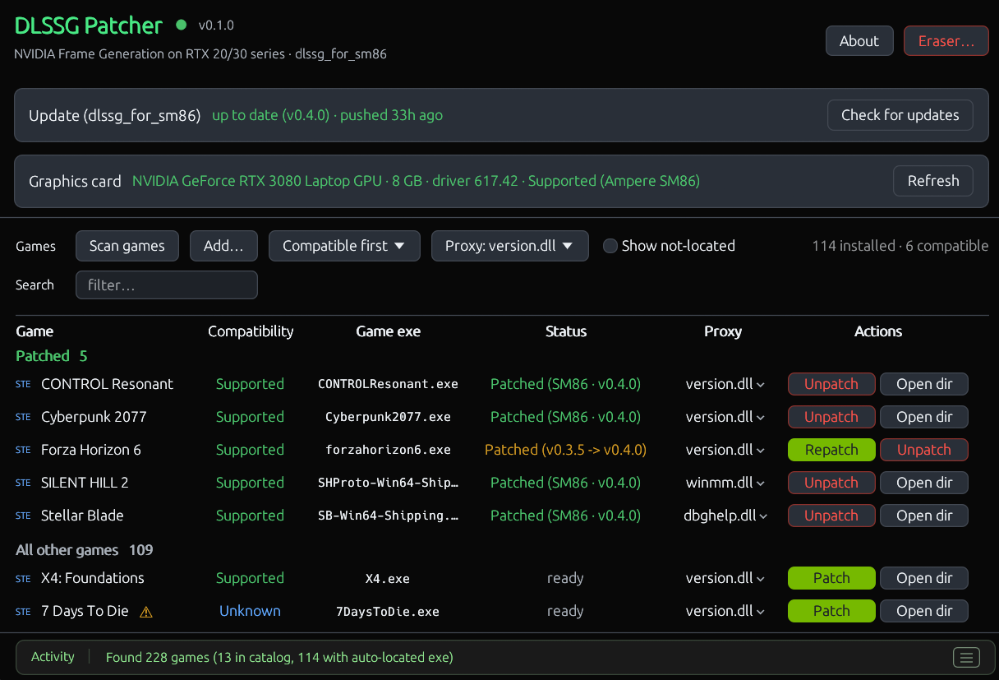

# DLSSG Patcher

A lightweight GUI for [dlssg_for_sm86](https://github.com/sdli1995/dlssg_for_sm86) to easily apply and manage NVIDIA Frame Generation on RTX 20/30-series GPUs across your installed games.

> **Warning:** Patching a game that uses anti-cheat, or going online with modded files, could result in a ban.

## What it does

- Downloads and caches the latest mod release (`version.dll`, alternative proxies, `dlssg_sm86.ini`, and the `dlssg_sm86` runtime folder)
- GPU & driver detection (RTX 20-series SM75 / RTX 30-series SM86)
- Scans Steam, Epic, GOG, Ubisoft, and EA libraries + manual game folders
- Checks whether a game supports Frame Generation (via NVIDIA's catalog or `nvngx_dlssg.dll` next to the `.exe`)
- One-click patch, unpatch, and repatch (upgrades older `0.3.x` patches to `0.4.0+` and backs up original game DLLs)
- Global and per-game proxy DLL selector 
- Anti-cheat detection, warning before patching
- Eraser: unpatches every game, restores any original files, and deletes all tool data in one click

## Troubleshooting

- If Frame Generation doesn't take effect in-game with the default `version.dll`, click `version.dll` in the **Proxy** column for that game, pick another proxy (like `winmm.dll` or `dxgi.dll`), and click **Repatch**. 
- Mod runtime logs are written to `dlssg_sm86\logs\` inside the game folder.
- Even if the game is supported, this does not guarantee that it will work with the mod. 

## Credits

- [sdli1995](https://github.com/sdli1995/dlssg_for_sm86) for the `dlssg_for_sm86` mod
- [Coldwood1026](https://github.com/Coldwood1026/dlssg_for_sm75) for RTX 20-series (SM75) support
- The executable statically links third-party Rust crates under their respective MIT / Apache-2.0 licenses.

## License

MIT License — see [LICENSE](LICENSE). The upstream mod is downloaded at runtime and governed by its own license. 
